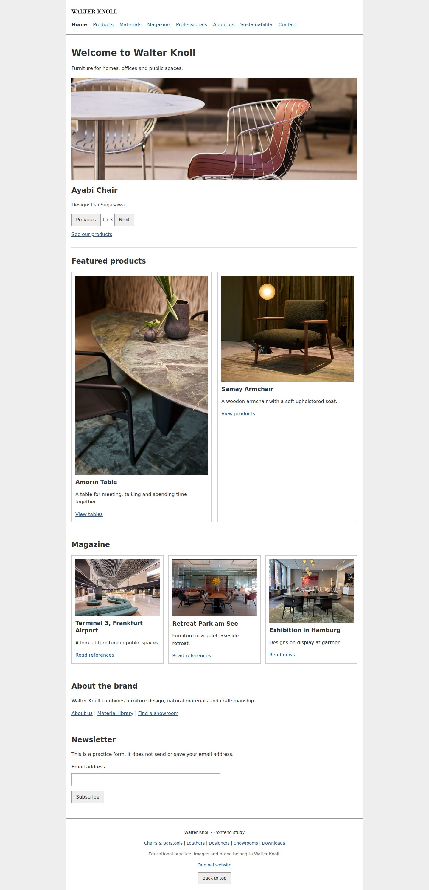

# Walter Knoll 静态网页练习

这是一个用 **HTML、CSS 和少量 JavaScript** 写的十页家具网站练习。当前是入门版：普通导航、居中内容、简单边框卡片，不再追求官网级的排版与交互。



## 打开网页

下载仓库后，直接双击 `index.html` 就能浏览。页面内容和图片都在本地，不需要安装依赖、启动后端或构建。

也可以在仓库目录运行 `npm run dev`，然后打开 `http://localhost:4173`。这个命令只启动一个本地静态文件服务。

## 十个页面

| 分工 | 文件 | 保留的练习 |
| --- | --- | --- |
| A | `index.html`、`pages/about.html` | 三张图片手动切换、产品和文章入口、品牌介绍、订阅表单演示 |
| B | `pages/products.html`、`pages/products-chairs.html` | 12 张产品卡片分类、12 款椅子两页切换 |
| C | `pages/materials.html`、`pages/materials-leathers.html` | 九类材料、FAQ 展开、15 张皮革色卡切换 |
| D | `pages/magazine.html`、`pages/professionals.html` | 九篇文章分类、八项服务、学习文件下载 |
| E | `pages/sustainability.html`、`pages/contact.html` | 简单图文、六家门店筛选、联系表单演示 |

表单只在当前页面显示提示，不发送邮件或创建订阅。产品信息和文章全文通过链接访问原官网。

## 从哪里改

- 文字、产品、文章、门店：直接改对应 HTML，不用先读数据接口。
- 基本字体和颜色：`css/base.css`。
- 页面宽度、导航、布局：`css/layout.css`。
- 卡片、按钮、表单：`css/components.css`。
- 某一页的样式：`css/pages/` 下对应文件。
- 简单交互：`js/pages/` 下对应文件。使用普通 `defer` 脚本和事件监听。
- 公共导航和页脚：改 `js/components/header.html`、`footer.html`，再运行 `npm run sync:components`。

导航和页脚已经写进每页 HTML，浏览时不依赖同步脚本。`assets/data/catalog.json` 是旧版资料索引，保留供查找素材，当前页面不读取它。

## 版本控制

- 完整改动前版本：`81f3d46`，另有 `backup/polished-20261015` 分支保留。
- 入门版在 `beginner-static-20261015` 分支开发，分开提交页面、检查和说明。
- 默认分支由 PR 合并后再更新；不强制推送、不重写旧提交。

可以用 `git log --oneline` 查看历史，用 `git diff main...beginner-static-20261015` 对比两版。旧版功能及文档仍可从旧提交查看。

## 开发检查（可选）

浏览网页不需要这些依赖。修改后需要自动检查时再运行：

```bash
npm ci
npm run check
npx playwright install chromium
npm test
```

`check` 检查十页、链接、图片、公共片段和脚本语法。浏览器测试检查本地直接打开的页面和基础交互，截图与结果写在 `artifacts/verification/`。实际执行结果见 [验证记录](docs/VERIFICATION.md)。

[项目说明与分工](docs/project-overview.md) · [本轮范围](docs/SPEC.md) · [素材来源](docs/references/README.md)

这是独立教学练习。品牌、图片和纹理属于原权利人，不代表 Walter Knoll 官方网站。
